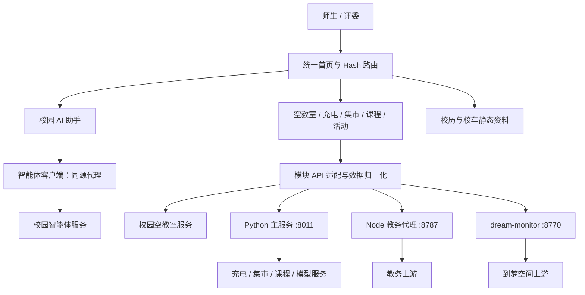

# 智启云聚 · 云南大学校园智能服务平台

**把分散的校园信息，汇聚到一个可提问、可查询、可核对的入口。**

TRAE 黑客松参赛项目 · 校园服务聚合 · AI 流式交互 · 真实数据接入 · 模块化 Web 应用

智启云聚面向云南大学师生，将校园 AI 助手、空教室、桦苑充电口、教师与课程、学期课程、课程历史给分、校园集市、到梦空间活动以及校历校车资料组织到统一界面。用户既可以用自然语言表达需求，也可以进入专用工具，按明确条件查询并查看结构化结果。

项目的技术重点是打通“**需求表达 → 服务请求 → 数据校验 → 结果呈现 → 异常反馈**”这条链路：对话负责降低使用门槛，专用工具负责提供可控的查询条件与可核对的数据。不同上游服务通过各自适配层接入，避免把接口差异和认证细节交给用户处理。

> **版本说明**：本文依据当前工作区实现整理。主站注册了 9 个功能模块；AI 课表另有实现，但尚未进入当前主站导航。部分服务需要校园网络、有效凭据或独立后端。本文分别说明代码能力、接入条件与验证范围，不将规划功能或测试数据当作线上成果。

## 评委快速阅读

| 评审关注点 | 项目提供的具体内容 | 阅读位置 |
| --- | --- | --- |
| 解决什么问题 | 校园信息入口分散，查询方式、筛选条件和登录状态不统一 | [场景与价值](#1-场景与价值) |
| 产品是否完整 | 统一首页、9 个主站模块、模块内查询与结果反馈 | [功能全景](#2-功能全景与完成边界) |
| AI 用在哪里 | 校园智能体流式交互、集市检索后生成、课表截图结构化识别 | [关键技术](#4-关键技术与实现细节) |
| 工程难点是什么 | 异构协议适配、凭据边界、流式分片、状态映射和请求竞态 | [系统架构](#3-系统架构)、[关键技术](#4-关键技术与实现细节) |
| 如何核实成果 | 源码索引、测试命令、启动步骤、现场演示脚本 | [验证](#7-测试与验证)、[演示](#8-现场演示建议) |
| 后续如何落地 | 统一网关、认证与部署完善、运行指标和跨校园适配 | [演进方向](#9-当前边界与演进方向) |

## 1. 场景与价值

### 1.1 从校园日常问题出发

“下午去哪里自习”“桦苑哪里还有空闲充电口”“某位老师这学期开了什么课”“活动还剩多少名额”，都是学生需要反复查询的问题。信息通常分布在教务系统、校园应用、第三方服务和通知图片里，用户需要记住不同入口，并反复理解各系统的操作方式。

智启云聚将这些需求组织为三类使用路径：

1. **带着问题进入**：通过校园 AI 助手，用自然语言开始查询与交流。
2. **带着条件进入**：在空教室、课程、集市等工具中设置条件，直接查看结果。
3. **带着位置或时间进入**：通过充电口平面布局、校历与校车资料，快速找到空间和时间信息。

### 1.2 方案价值与创新点

- **对话与专用工具互补**：保留自然语言入口，也保留筛选、分页、详情、布局等结构化操作，让不同熟练程度的用户都能完成任务。当前各工具可独立访问；校园智能体能调用哪些上游能力，取决于智能体平台自身配置。
- **将状态转为可行动的信息**：充电模块把设备数组转换成具体端口位置；空教室模块把条件查询结果进一步按教学楼、座位数和关键字组织，帮助用户做下一步选择。
- **为 AI 回答提供数据约束**：集市模块先读取真实帖子，再将检索结果交给模型组织回答；数据源不可用时返回错误，不用生成内容填补检索失败。
- **以可复用模块承载校园服务**：界面、请求适配、数据规则和模块生命周期分开维护，为后续增加其他校区或服务保留扩展空间。

上述价值是设计目标与实现机制。项目尚未提供用户规模、查询耗时改善率或满意度调查，因此不宣称未经测量的效率提升比例。

## 2. 功能全景与完成边界

主站入口为 `http://127.0.0.1:8000/`，以下路径均使用 Hash 路由。

| 模块 | 主站路径 | 已实现的主要能力 | 数据与运行条件 |
| --- | --- | --- | --- |
| 校园 AI 助手 | `/#/ai-assistant` | 应用配置读取、创建会话、SSE 流式回答、Markdown 呈现、历史消息读取 | 需校园智能体 AppID / API Key 及上游网络；代理模式需额外接入代理服务 |
| 空教室查询 | `/#/empty-classroom` | 校区、教学周、星期、节次与教学楼查询；关键字、座位数、可借用条件筛选 | 经 `/hiagent` 对接校园服务；“无排课”不等同于现场无人或一定可借用 |
| 桦苑充电口 | `/#/charging-map` | 平面布局、空闲与占用状态、未知状态、空闲端口列表及统计 | Python 提供 `/api/charging/ports`；当前主站需补齐该路径转发 |
| 校园集市 | `/#/market-agent` | 最新帖、热门帖、关键词搜索、自然语言检索与模型回答 | 需赞哦数据源与模型配置；独立联调入口已提供，主站转发需补齐 |
| 教师 / 课程 | `/#/teacher-course-search` | 按教师或课程检索、分页、教学类型及课程详情 | Node 教务代理与有效 `EHALL_COOKIE` |
| 学期课程 | `/#/term-course-list` | 按学期代码查看课程、教师及课程安排 | Python 代理与有效 `WECAMPUS_TOKEN`；不提供个人成绩或绩点 |
| 课程给分 | `/#/course-grades` | 按课程名或教师检索；历史平均分、最高分、样本数和分数段占比 | Python 代理与有效 `WECAMPUS_TOKEN`；为上游历史统计，不代表个人成绩或未来得分 |
| 校历与校车 | `/#/campus-calendar` | 两个学期的校历图片及校车时刻资料 | 本地 WebP 静态资源；不提供车辆实时定位 |
| 到梦空间 | `/#/dreamspace-events` | 账号登录、活动列表、状态与名额、详情、刷新和退出 | 独立 `dream-monitor` 后端及用户自己的有效账号；仅查询，不报名或取消报名 |

**扩展模块：AI 课表。** `src/modules/timetable/` 已包含截图识别、识别结果确认、周次规则、课程冲突提示、本地保存和 JSON 导入导出；`server/app.py` 提供识别接口。但当前 `src/main.js` 使用的主站注册表尚未注册该模块，因此不计入上述 9 个主站入口，也不作为默认现场演示步骤。

## 3. 系统架构

### 3.1 分层与请求链路



图中表示模块的数据链路。各链路是否能在同一页面运行，取决于开发代理或部署网关是否正确配置；当前实际转发情况见下文。

| 层级 | 技术选择 | 承担的职责 |
| --- | --- | --- |
| 前端构建 | Vite 7、原生 JavaScript ES Modules、HTML5、CSS3 | 开发服务、模块拆分和静态资源构建；不依赖 React / Vue |
| 应用外壳 | `src/shell/`、`src/modules/registry.js` | 首页、导航、动态模块加载、错误兜底与卸载 |
| 模块业务 | `src/modules/*` | 视图、查询状态、纯函数规则及服务适配 |
| 共享能力 | `src/shared/` | 通用同源请求、智能体请求、运行配置、用户标识与通知 |
| Python 主服务 | Python 3、标准库 `ThreadingHTTPServer` | 集市编排、充电代理、学期课程、课程给分、课表识别和可选静态资源服务 |
| 教务代理 | Node.js HTTP 服务、Undici | 教务 Cookie 注入、请求超时及课程接口适配 |
| 活动后端 | 锁定版本的 `dream-monitor` | 用户会话、活动查询和数据缓存；本项目增加只读与凭据保护补丁 |

### 3.2 当前开发环境的实际转发

`npm run dev` 使用根目录 `vite.config.js`，默认监听 `127.0.0.1:8000`。代理按以下顺序匹配，精确业务路径先于通用 `/api`：

| 请求路径 | 当前目标 | 说明 |
| --- | --- | --- |
| `/api/me`、`/api/login`、`/api/logout`、`/api/state`、`/api/refresh`、`/api/activity` | `127.0.0.1:8770` | 到梦空间会话与查询；由 `DREAM_MONITOR_TARGET` 覆盖目标 |
| `/hiagent` | 校园空教室上游 | 开发期跨域适配 |
| `/api/term-courses`、`/api/course-grades` | `127.0.0.1:8011` | Python 课程服务；由 `TERM_COURSES_TARGET` 覆盖目标 |
| 其他 `/api` | `127.0.0.1:8787` | 当前 Node 入口仅处理 `/api/courses` |

**接入注意**：Python 已实现的集市、充电和课表识别接口，以及 AI 的 `/api/agent/*` 代理，尚未在当前主站 Vite 配置中分别接通。仅启动所有进程不能自动解决路径分发。集市可以使用 `npm run dev:market` 的独立配置验证；其他链路须在演示部署的网关中接入对应目标。

## 4. 关键技术与实现细节

### 4.1 轻量应用外壳：按需加载与生命周期管理

主站通过 `registry.js` 维护模块的路径、标题、说明、图标和动态 `import()` 入口。路由进入某个模块时才加载其实现，模块统一导出 `mount(rootElement, context)`，并返回清理函数或带 `unmount()` 的实例。

路由层使用递增的 `navToken` 校验异步加载结果：用户连续切换页面时，旧页面的加载结果不会覆盖新页面。切换前调用上一模块的清理函数，使模块能够取消请求、释放事件监听和停止定时任务。模块加载失败时展示兜底页面，避免整个应用失去导航能力。

**源码依据**：[模块注册](src/modules/registry.js)、[路由与生命周期](src/shell/router.js)、[统一请求客户端](src/shared/api.js)。

### 4.2 校园 AI：处理真实流式协议，而非模拟逐字输出

校园 AI 助手围绕 `chat_query_v2` 实现请求与响应处理：

1. 读取应用配置，创建会话，并携带 `UserID` 与 `AppConversationID` 发送问题。
2. 优先使用 `ResponseMode=streaming`，通过 `ReadableStream` 和 `TextDecoder` 读取网络分片。
3. SSE 解析器缓存尚未完整到达的内容，按事件边界解析；处理消息、结束与替换等事件。
4. 回答合并逻辑兼容增量文本和累计文本，避免重复拼接相同片段。
5. 上游不支持流式响应时回退到 blocking 请求；鉴权失败、限流、超时、取消和空回答分别反馈。
6. 展示层只呈现回答内容，过滤推理及工具消息；Markdown 渲染先转义 HTML，再识别语法，链接限定允许的协议。

浏览器未显式配置用户标识时，会生成并持久化本地标识，减少不同浏览器误用同一固定会话身份的情况；该标识不等同于学校统一身份认证。

**源码依据**：[智能体编排](src/modules/ai-assistant/agent-api.js)、[SSE 解析](src/modules/ai-assistant/sse.js)、[响应归一化](src/modules/ai-assistant/parse.js)、[Markdown 渲染](src/modules/ai-assistant/markdown.js)、[用户标识](src/shared/user-id.js)。

### 4.3 充电口地图：将设备状态精确映射到空间位置

充电模块将固定布局与动态状态分开维护。布局为 **51 行 × 15 列、500 个唯一端口位置、30 台设备**，通过“设备号—端口号”连接服务响应与界面单元格；这些数字描述当前布局规模，不代表每次刷新都成功读取全部设备。

- **处理端口下标差异**：已核对的响应中，`ports[0]` 是占位项；真实端口从索引 1 开始。读取前要求数组长度等于 `portNumber + 1`，避免整体错位。
- **校验状态含义**：代码记录的上游核对结果为 `0=空闲`、`1=占用`。其他整数显示为“故障/未识别”；结构不符合约定时保留未知状态。
- **按设备隔离失败**：单台设备请求失败，不阻止其他设备状态渲染；未知状态不计入空闲，结构校验失败时隐藏依赖该结构的统计。
- **约束布局真实性**：10 端口设备不会被补出 11—20 号端口；空闲列表只从已确认状态生成，并按设备号、端口号排序。
- **服务端控制请求**：充电核心提供并发数与单次请求超时配置，避免无约束地向全部设备发起请求。

**源码依据**：[平面布局](src/modules/charging-map/layout.js)、[校验与状态索引](src/modules/charging-map/logic.js)、[充电代理](server/charging_core.py)、[布局与边界测试](tests/charging-map-logic.test.mjs)。

### 4.4 校园集市：检索先行、生成有据

集市模块使用可替换的 `MarketService` 读取真实数据。当前适配赞哦的最新帖、热门帖与关键词搜索；模型通过服务端的 Chat Completions 兼容接口调用。

```text
用户表达需求
  → 规则判断是否为集市查询
  → 保守提取检索词
  → 真实数据源搜索
  → 最多 20 条帖子作为本轮模型上下文
  → 模型组织回答，同时返回结构化检索结果
```

编排层对单条消息限制为 2,000 字，历史最多保留 20 条、总计 20,000 字；检索词最长 40 字。帖子 JSON 被放入明确的数据分隔区，提示模型忽略帖子中的指令，缺失字段写“未提供”，空结果写“未检索到”。这些措施用于约束上下文和降低编造风险，不代表模型回答已经获得形式化真实性保证。

规则提取会去掉部分价格和口语噪声，因此当前能力是自然语言辅助检索，不能将“预算 300 元”等表达宣传为已经完成严格价格过滤。页面区分“已配置”和“请求验证成功”，真实连通性仍需执行一次查询确认。服务仅提供读取，不提供发帖、评论或交易写操作。

**源码依据**：[意图与关键词](server/market_intent.py)、[检索与生成编排](server/market_agent.py)、[数据源适配](server/market_service.py)、[模型客户端](server/model_client.py)。

### 4.5 空教室与课程：先归一化，再筛选与展示

**空教室**将接口、状态控制器与视图规则拆分，分别处理选项加载、参数校验、查询状态、结果缓存及本地筛选。查询使用上游返回的选项；结果可按关键字、最少座位数和可借用条件筛选，再按教学楼组织。控制器测试覆盖旧请求晚到、取消和失败恢复等情况。

**教师 / 课程查询**将教师姓名映射到上游字段 `SKJS`，将课程名映射到 `KCM`；分页数量依据 `totalSize` 计算，不把当前页条数当作总数。课程行优先使用教学班 ID，回退到课程号与课序号组合，避免把同名的不同教学班混为一条。

**学期课程与课程给分**通过服务端注入 `WECAMPUS_TOKEN`，只回传业务字段白名单。给分模块根据真实样本人数计算分数段占比；没有有效样本时显示暂无数据，不推算成绩。查询还约束文本长度、页码、上游响应体大小和超时，禁止自动重定向，减少非预期响应进入业务界面的机会。

**源码依据**：[空教室控制器](src/modules/empty-classroom/controller.js)、[课程规则](src/modules/teacher-course-search/course-utils.js)、[学期课程核心](server/term_courses_core.py)、[给分代理](server/course_grades_core.py)、[给分展示规则](src/modules/course-grades/logic.js)。

### 4.6 到梦空间：复用上游后端，明确二次开发贡献

活动后端采用仓库内锁定的 `dream-monitor` 源码，上游版本及提交记录见 [接入说明](vendor/dream-monitor/ZHIHEY-INTEGRATION.md)。本项目提供统一前端，并增加以下集成修改：

- 删除 `/api/state` 顶层上游 token；前端遇到该字段时拒绝读取响应。
- `/api/signup`、`/api/cancel`、`/api/token` 返回只读拒绝，限制网页端写操作与强制重登能力。
- 通过同源代理维护 `HttpOnly; SameSite=Lax` 会话 Cookie，HTTPS 部署支持 `DM_COOKIE_SECURE=1`。
- 增加启动器，固定工作目录，避免配置和数据库落到错误位置；增加无需真实账号的补丁测试。

后端会持久化账号会话和缓存，相关目录属于敏感数据。其本地密码加密可解密，不能将“浏览器拿不到 token”表述为“服务端不保存账号数据”。

### 4.7 扩展能力：AI 课表的人工确认与确定性规则

AI 课表将截图识别与课表规则分开：前者提取课程字段，后者计算单双周、周次区间、当前教学周和课程冲突。图片在浏览器内缩放至最长边约 2,200 像素后，再将处理后的图像发送至服务端识别；模型密钥不由浏览器提交。

识别结果缺少关键字段时保留记录并标记待确认，避免擅自补全周次。用户确认后才进入本地课表；支持本地保存、手动编辑和 JSON 导入导出。该流程体现“模型负责提取、规则负责计算、用户负责确认”的设计，但仍需补齐当前主站入口与识别接口转发。

**源码依据**：[课表模块](src/modules/timetable/)、[图片处理](src/modules/timetable/image.js)、[识别核心](server/schedule_core.py)、[规则测试](tests/timetable.test.mjs)。

## 5. 数据、认证与可靠性

| 处理环节 | 当前做法 | 需要保留的边界 |
| --- | --- | --- |
| 服务端凭据 | 教务 Cookie、集市 Token、课程 Token 与模型密钥通过私有配置或环境变量读取 | 不提交真实值；不同服务的配置加载顺序不同，见运行说明 |
| AI 服务端代理 | 浏览器只访问 `/api/agent/*` | AppID / API Key 仅保留在服务端；旧直连配置不再支持 |
| AI proxy 模式 | 客户端支持同源 `/api/agent/*`；仓库有代理实现 | 当前主站需接入代理服务与路由，不能只改一个环境变量便认为部署完成 |
| 数据输出 | 部分接口使用字段白名单；模型文本先转义；错误信息结构化 | 上游内容和模型输出仍需按具体场景核对 |
| 请求失败 | 超时、鉴权失效、空结果、网络错误分别反馈；充电失败按设备隔离 | 上游不可用时，不能保证对应实时功能可用 |
| 活动数据 | Cookie 会话；本地账号库与缓存目录被忽略 | 不公开分享 `data/`、配置、截图中的账号与凭据 |
| 测试数据 | 单元测试使用固定响应或本地测试服务 | 测试数据用于验证逻辑，不充当真实业务结果 |

项目未实现面向公网的完整统一认证、统一限流与运维审计。公开部署前应完善入口鉴权、HTTPS、凭据轮换与数据保留策略。

## 6. 本地运行与配置

### 6.1 环境与依赖

建议 Node.js **22.19+**、Python **3.10+**，并准备各模块经授权使用的服务凭据。Node 版本需同时满足 Vite 与 Undici 的依赖要求，当前 Undici 8.12.3 要求 Node ≥22.19.0。以下命令均在本 README 所在的 `ZhiHeYunQi` 目录执行。

```powershell
npm install
python -m venv .venv
.venv\Scripts\python.exe -m pip install -r requirements.txt
```

先启动主站查看首页和静态资料：

```powershell
npm run dev
```

打开 `http://127.0.0.1:8000/`。仅启动前端不会自动启动后端，也不会自动获得学校或第三方认证。

### 6.2 配置文件与关键变量

[`.env.example`](.env.example) 仅列出变量示例，不包含可用凭据。创建 `.env.local` 前先检查是否已有配置，避免覆盖。集市配置单独放在 `.env.market`；以上私有文件均被 Git 忽略。

| 服务 | 关键变量 | 配置读取方式 |
| --- | --- | --- |
| Vite 与 AI 同源代理 | `VITE_AGENT_TRANSPORT=proxy`、`AGENT_PROXY_TARGET` | 默认转发到 `127.0.0.1:8788`；开发及构建均拒绝前端凭据变量 |
| AI 服务端代理 | `AGENT_TRANSPORT`、`AGENT_ORIGIN`、`AGENT_APP_ID`、`AGENT_API_KEY` | Node 代理读取服务端配置；开发和部署入口均已配置路由 |
| Python 主服务 | `APP_HOST`、`APP_PORT` | 进程环境优先；依次加载 `.env.market`、`.env`，不覆盖已有值 |
| 校园集市 | `MARKET_PROVIDER=zanao`、`ZANAO_TOKEN`、`ZANAO_SCHOOL_ALIAS`、`ZANAO_SEARCH_CATEGORY_ID` | 建议放 `.env.market`；学校别名和分类必须与实际服务匹配，示例值不代表云南大学配置 |
| 集市模型 | `OPENAI_BASE_URL`、`OPENAI_API_KEY`、`OPENAI_MODEL` | Python 服务端配置；接口兼容不代表绑定某一家模型供应商 |
| 学期课程 / 给分 | `WECAMPUS_TOKEN` | 进程环境优先，`.env.local` 兜底；`TERM_COURSES_TARGET` 设置 Vite 转发目标 |
| 教师 / 课程 | `EHALL_COOKIE`，可选 `EHALL_BASE_URL`、`EHALL_REFERER`、`EHALL_PROXY` | Node 读取进程环境及 `.env.local`、`.env`；会话过期需更新 |
| 到梦空间 | `DREAM_MONITOR_TARGET`、后端 `config.yaml` | Vite 转发目标与独立后端配置；用户在页面登录 |
| 扩展课表识别 | `DEEPSEEK_BASE_URL`、`DEEPSEEK_MODEL`、`DEEPSEEK_API_KEY` | 识别核心读取服务端配置；实际模型端点必须支持图像输入 |

不要把教务、集市、课程或模型凭据改成 `VITE_` 变量。修改配置后重启相应进程；前端变量在构建后改变还需要重新构建。

### 6.3 按需启动后端

**Python 主服务：**

```powershell
.venv\Scripts\python.exe server/app.py
```

默认监听 `http://127.0.0.1:8011`，健康检查为 `/api/health`。学期课程、课程给分、集市、充电和课表识别均由开发入口转发至该服务。

**校园 AI 代理：**

```powershell
npm run api:agent
```

默认监听 `http://127.0.0.1:8788`，可通过 `AGENT_PROXY_PORT` 设置；旧私有文件中的 `PORT=5173` 不再改变 AI 端口。进程环境中的 `PORT` 仍兼容部署脚本。开发入口和 AI 代理需分别启动；只启动 `npm run dev` 不会启动 AI 后端。

在 `.env.local` 中设置服务端 `AGENT_ORIGIN`、`AGENT_APP_ID`、`AGENT_API_KEY`。浏览器默认采用代理模式，不配置任何凭据。
旧配置迁移时，将 `VITE_AGENT_APP_ID`、`VITE_AGENT_API_KEY` 的值移至对应 `AGENT_` 变量，删除前端凭据变量及 `VITE_AGENT_ORIGIN`，将传输模式改为 `proxy`。已有服务端值优先，迁移前应核对其有效性。

**教师 / 课程代理：**

```powershell
npm run api:courses
```

默认监听 `http://127.0.0.1:8787`。配置有效教务会话后，从主站教师 / 课程页面查询。

**到梦空间后端：**

```powershell
.venv\Scripts\python.exe -m pip install -r vendor/dream-monitor/requirements.txt
# 仅首次且 config.yaml 不存在时复制，避免覆盖现有配置
Copy-Item vendor/dream-monitor/config.example.yaml vendor/dream-monitor/config.yaml
.venv\Scripts\python.exe scripts/dream-monitor.py
```

默认监听 `http://127.0.0.1:8770`；在主站活动页面使用自己的账号登录。启动器也可通过 `npm run dev:dream-monitor` 调用，但需确保当前终端的 `python` 已安装对应依赖。详细数据目录、版本与部署说明见 [到梦空间接入文档](vendor/dream-monitor/ZHIHEY-INTEGRATION.md)。

开发时分别启动前端和所需后端；后端未启动时，开发网关返回带服务启动提示的 JSON 错误（HTTP 502），不会自动启动对应服务。前端统一从 `http://127.0.0.1:8000` 访问。

| 后端 | 端口 | 开发与部署接口归属 |
| --- | --- | --- |
| Python 主服务 | 8011 | `/api/health`、`/api/config`、`/api/chat`、`/api/market/*`、`/api/term-courses`、`/api/course-grades/*`、`/api/charging/ports`、`/api/schedule/recognize` |
| Node AI 代理 | 8788 | `/api/agent/*`，保留四个上游接口白名单 |
| Node 课程代理 | 8787 | `/api/courses` |
| 到梦空间 | 8770 | `/api/me`、`/api/login`、`/api/logout`、`/api/state`、`/api/refresh`、`/api/activity` |

`/hiagent` 继续使用已有空教室代理。`TERM_COURSES_TARGET` 设置 Python 主服务目标，`AGENT_PROXY_TARGET` 和 `COURSE_API_TARGET` 分别设置两个 Node 服务目标。部署由 Nginx 提供相同的路由归属；不将开发代理配置视为静态部署的一部分。
本次仍用于受控的封闭演示，不新增公共注册或统一认证。

### 6.4 校园集市独立联调

配置 `.env.market` 并启动 Python 服务后，在另一个终端执行：

```powershell
npm run dev:market
```

打开 `http://127.0.0.1:5300/market-agent.html`。该配置将 `/api` 转发至 `8011`，适合独立验证集市链路。先执行最新帖、热门帖或关键词搜索，确认数据源连通，再体验模型回答。

### 6.5 构建与部署

```powershell
npm run build
npm run preview
```

构建产物输出到 `dist/`。`preview` 用于查看构建页面，不能据此认定业务 API 已完成生产部署；开发期 `server.proxy` 也不会随静态产物发布。

部署时需由同源网关分发活动 API、Python 业务 API、Node 教务 API、校园空教室 API，以及启用时的 AI 代理。流式链路应关闭会阻碍 SSE 的响应缓冲，设置适当超时；活动 Cookie 使用 HTTPS 与 `DM_COOKIE_SECURE=1`。Python 主服务可以托管静态目录，但不代替其他后端的网关能力。

## 7. 测试与验证

### 7.1 本次文档整理时实际执行的检查

2026 年 10 月 25 日，在当前工作区完成：

| 检查 | 结果 | 能证明什么 |
| --- | --- | --- |
| `npm run build` | 通过；Vite 转换 55 个模块并生成构建产物 | 当前主站可以构建，模块与资源依赖可解析 |
| 下列组合测试 | 72 项通过，0 失败 | 空教室 API / 控制器 / 规则、充电布局、课表规则和课程给分前端逻辑符合测试约定 |

```powershell
node --test tests/charging-map-logic.test.mjs tests/timetable.test.mjs tests/course-grades.test.mjs src/modules/empty-classroom/__tests__/logic.test.js src/modules/empty-classroom/__tests__/controller.test.js src/modules/empty-classroom/__tests__/api.test.js
```

构建和单元测试不证明上游服务在线、凭据有效或现场演示全部连通。本次整理未执行真实账号登录、外部服务端到端验收或并发压力测试，也未新增性能数据。

### 7.2 仓库提供的其他验证入口

以下命令用于按模块复核，本次不将其列为已执行通过：

```powershell
npm run test:ai
npm run test:courses
npm run test:dreamspace
npm run test:dream-backend
npm run test:market
python -m unittest server.tests.test_schedule_core server.tests.test_term_courses server.tests.test_charging_proxy -v
```

测试覆盖重点包括：SSE 分片与响应归一化、Markdown 转义、请求超时与取消、教务分页与会话失效、活动只读补丁、集市数据源及模型错误、课表图片与字段校验。Python 测试请在已安装相关依赖的环境中运行；带测试替身的验证与真实服务验收应分别记录。

### 7.3 推荐的现场验收记录

| 验收对象 | 观察点 |
| --- | --- |
| 空教室 | 查询条件与结果一致；改动本地筛选后数量正确；错误时能够重试 |
| 校园 AI | 能创建会话、逐步显示回答；历史与当前会话对应；失败不显示虚构答案 |
| 充电地图 | 布局位置可定位，刷新时间可见；失联设备保持未知 |
| 集市 | 原始帖子卡片与生成回答可对照；无结果时不生成商品信息 |
| 课程 | 学期、教师和教学班能对应；缺失信息与历史统计边界清晰 |
| 活动 | 登录、列表、详情、刷新、退出可完成；没有报名或取消操作 |

## 8. 当前边界与演进方向

| 阶段 | 具体工作 | 验收方式 |
| --- | --- | --- |
| 完善比赛部署 | 统一主站业务转发；将 AI proxy 接入主站；完成各模块真实查询记录 | 从同一域名完成查询与错误恢复，无需切换独立联调页 |
| 完善课表集成 | 注册 AI 课表入口，接通识别接口并验证所选视觉模型 | 上传、确认、保存、按周查看与冲突提示形成完整流程 |
| 加强运行保障 | 统一入口鉴权、限流、脱敏日志、上游可用性监测与敏感数据保留规则 | 形成明确的权限检查、错误统计及配置管理流程 |
| 量化产品价值 | 测量任务完成时间、查询成功率、首段响应时间及用户反馈 | 用真实测量报告支持效率结论 |
| 扩展校园服务 | 将校区选项、布局和服务 Provider 配置化；评估更多校园信息入口 | 用新增服务验证模块协议与适配层的复用程度 |

## 9. 源码导航与第三方说明

```text
ZhiHeYunQi/
├── index.html                    # 主站页面
├── market-agent.html             # 集市独立联调页面
├── src/
│   ├── main.js                   # 当前主站入口
│   ├── shell/                    # 首页、路由和加载兜底
│   ├── shared/                   # 请求、配置、用户标识与通知
│   ├── modules/registry.js       # 当前 9 个主站模块
│   ├── modules/*/                # 各模块视图、API 和业务规则
│   └── dev/                      # 集市独立开发配置
├── server/
│   ├── app.py                    # Python 主服务实际启动入口
│   ├── index.js                  # Node 教务代理
│   ├── market_*.py               # 集市意图、数据源与对话编排
│   ├── charging_core.py          # 充电状态代理
│   ├── term_courses_core.py      # 学期课程共享核心
│   ├── course_grades_core.py     # 历史给分查询核心
│   ├── schedule_core.py          # 截图识别与结果校验
│   ├── routes/                   # 路由适配；并非全部挂载到当前主入口
│   └── tests/                    # Python 测试
├── tests/                        # JavaScript 测试
├── test/、dev/                    # 模块测试与独立验证页面
├── vendor/dream-monitor/         # 锁定上游源码与本项目补丁说明
├── scripts/                      # 启动及验证辅助脚本
├── vite.config.js                # 主站开发代理与构建配置
├── .env.example                  # 无真实凭据的变量说明
└── requirements.txt              # Python 主服务依赖
```

本项目的贡献包括校园服务界面、模块化应用外壳、多服务适配、AI 交互与数据处理逻辑，以及活动后端的集成补丁。到梦空间后端复用了第三方源码，其来源、锁定提交及修改范围见 [ZHIHEY-INTEGRATION.md](vendor/dream-monitor/ZHIHEY-INTEGRATION.md)，不得将整个上游项目归为本项目原创。其他依赖遵循各自许可；公开分发时应保留相关声明，并核对校园数据与第三方服务的使用授权。

提交约定见 [GIT_WORKFLOW.md](GIT_WORKFLOW.md)。本地配置、账号库、日志与构建中可能包含的敏感内容，应在分享演示包和提交前检查；提交由项目维护者手动完成。
